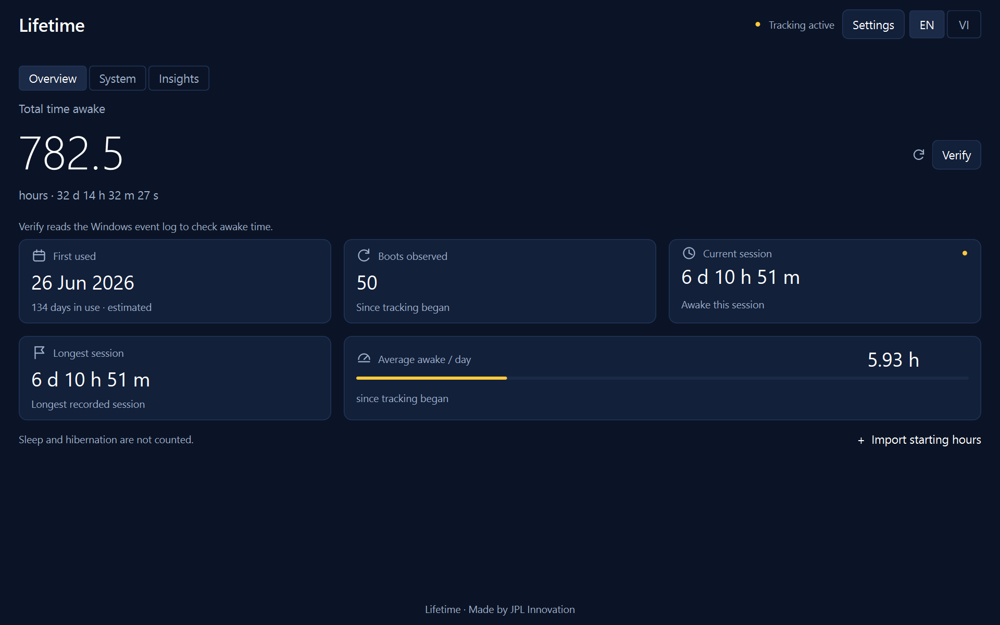
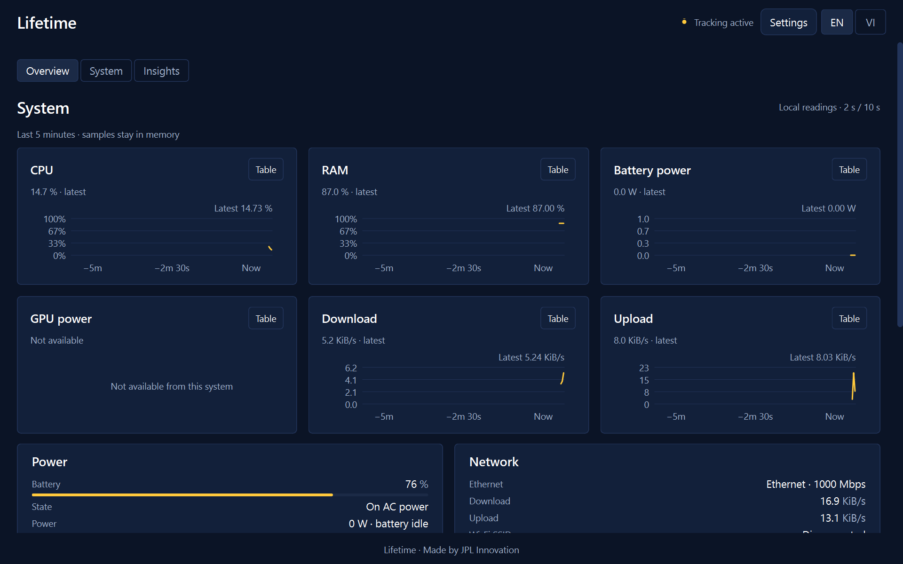
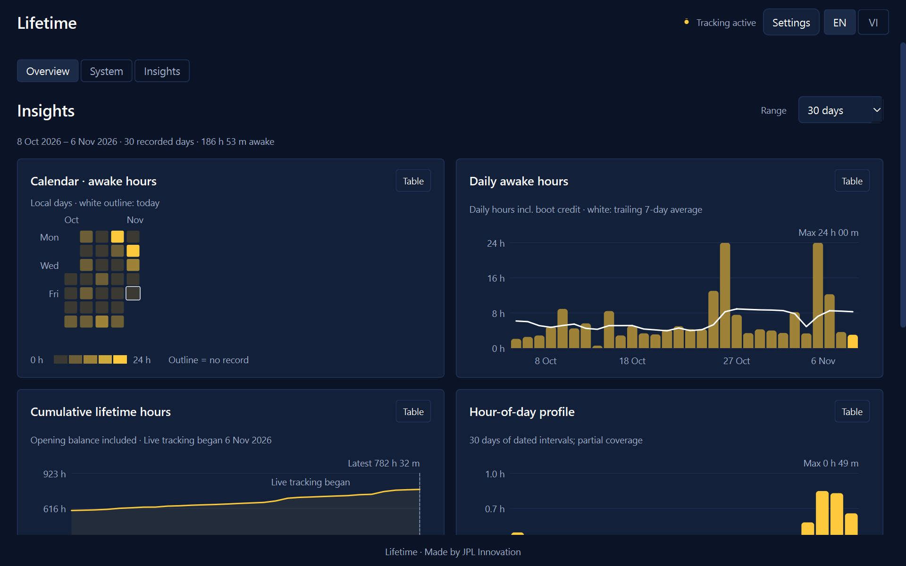

# Lifetime

**Lifetime shows how long your computer has really been awake, since it was first used.** Sleep, hibernation and Windows Fast Startup are never counted. It runs on Windows and Linux, in English and Tiếng Việt.

Made by [JPL Innovation](https://github.com/jpl-innovation).



| System | Insights |
|---|---|
|  |  |

## Download

Go to the **[latest release](../../releases/latest)** and pick your system.

### Windows 10 / 11 (no Python needed)

1. Download **Lifetime-Windows.zip** and unzip it.
2. Double-click **Install Lifetime.cmd**.
3. Approve the Windows prompt (see "Why admin?" below) and open **Lifetime** from the Start menu.

The downloaded programs are not code-signed, so Windows SmartScreen may say "Windows protected your PC". Click **More info → Run anyway**. If your organisation blocks unsigned programs (Smart App Control / App Control), use the Python route below.

**Python route** (works anywhere Python 3.9+ is installed):

```powershell
python -m pip install PyQt6
.\install_windows.ps1
```

### Linux

1. Download **Lifetime-Linux.tar.gz**, then:

```sh
tar -xzf Lifetime-Linux.tar.gz
cd Lifetime-Linux
bash install_linux.sh
```

2. Open **Lifetime** from your application menu.

The installer needs Python 3 and PyQt6 and offers to install PyQt6 for you (no sudo, unless you choose to allow journal access). Distribution packages: `python3-pyqt6` (Debian/Ubuntu/Fedora) or `python-pyqt6` (Arch). It sets up a systemd **user** service, so no root rights are needed.

## What it shows

- **Overview** – total awake time, ticking live to the second, with first-used date, boots, current and longest session, and daily average. A **Verify** button cross-checks the number against the operating system's own records (the Windows event log or the Linux journal).
- **System** – live power and battery, network and Wi-Fi, graphics, CPU, memory and disks, with five-minute sparklines.
- **Insights** – calendar heatmap, daily hours with a 7-day average, cumulative lifetime hours, hour-of-day and weekday profiles, and a session-length histogram. Every chart has a table view.

## Privacy and consent

On first run Lifetime asks, one question at a time, what you want to track. Awake time is the only required item; battery, network, Wi-Fi name, graphics and resource readings are each opt-in, and anything you turn off is never read. Everything stays on your computer; nothing is uploaded. You can change choices, switch language, or delete collected history in **Settings**.

**Why admin on Windows?** Rebuilding past history reads the full System event log and registering the login task works best with administrator rights. If you decline the prompt, Lifetime installs for your user only and history rebuild may be limited. The installer never installs files into the administrator's profile.

## How it counts

The tracker samples every 30 seconds using an awake-only clock (`QueryUnbiasedInterruptTime` on Windows, `CLOCK_MONOTONIC` on Linux), so suspend and hibernation are excluded and wall-clock changes cannot distort it. Gaps over five minutes start a new session. Each newly seen boot credits its awake time so far once, spread across the days it actually happened (never more than 24 h per day). Past history before tracking began can be rebuilt from the system logs, which is exact only as far as those logs go.

On the developer's laptop, the awake time reported by Lifetime matched the Windows event log to within a few minutes.

## Files and data

Data lives in `%APPDATA%\Lifetime\` (Windows) or `~/.local/share/lifetime/` (Linux): `ledger.json` (the record), `settings.json`, `status.json`. Back up `ledger.json` to keep your history. Uninstall: remove the *Lifetime Tracker* scheduled task / `lifetime-tracker.service`, the shortcut, and the install folder.

## Build from source

```sh
python -m pip install PyQt6
python lifetime_gui.py          # open the window
python lifetime_tracker.py --run   # run the tracker
python -m unittest discover     # tests
```

Windows executables: `./build_windows.ps1` (needs `pyinstaller`, produces `package\`). Releases are built automatically by GitHub Actions when a version tag such as `v1.0.0` is pushed.

## Supported systems

Windows 10 and 11 (x64 and ARM64), and Linux with systemd and Python 3.9+. Desktops without a battery or without an NVIDIA GPU are handled. Windows 10, ARM64, non-English Windows and Linux paths are covered by automated tests but have had less real-world testing than Windows 11 x64.

## Credits

Lifetime · Made by JPL Innovation
