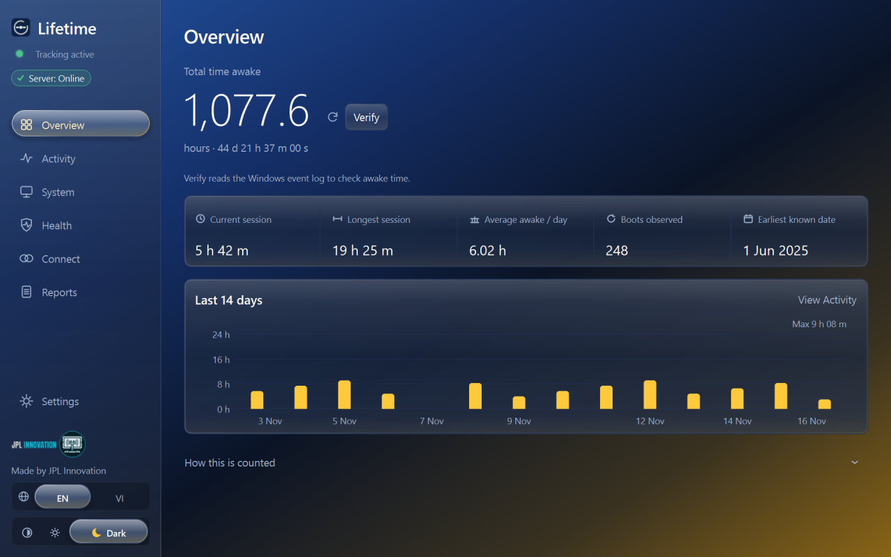
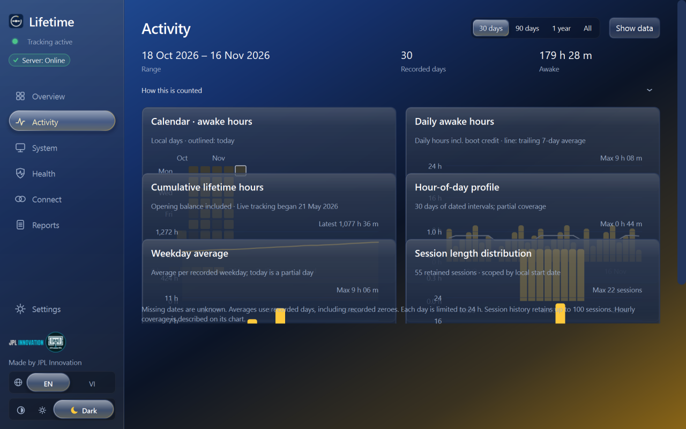
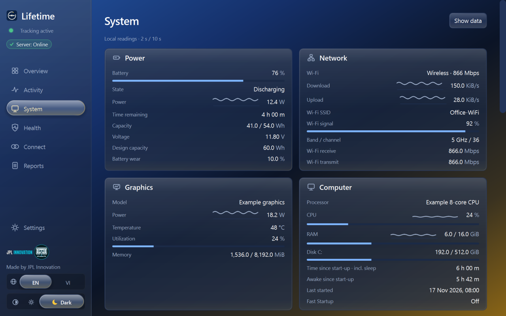
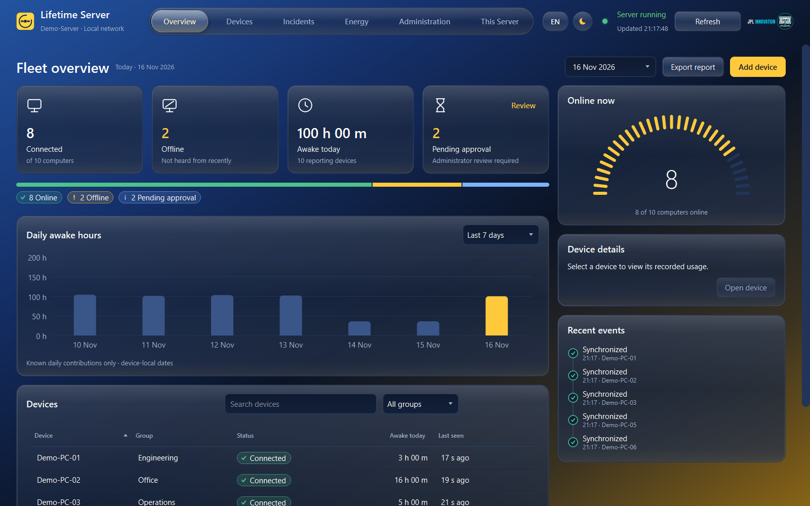
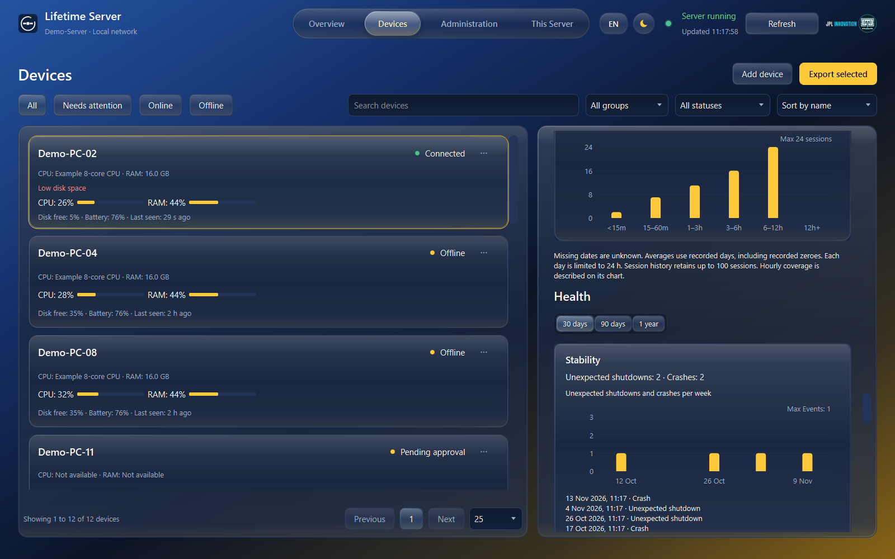
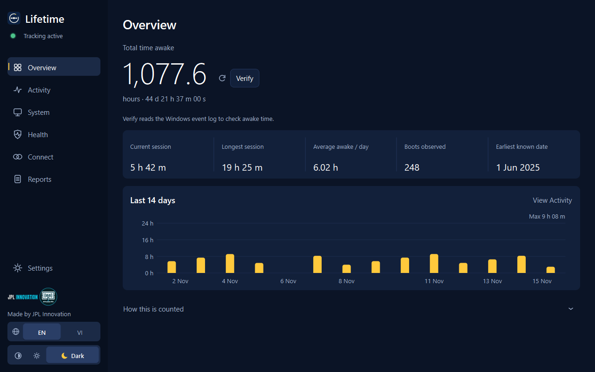
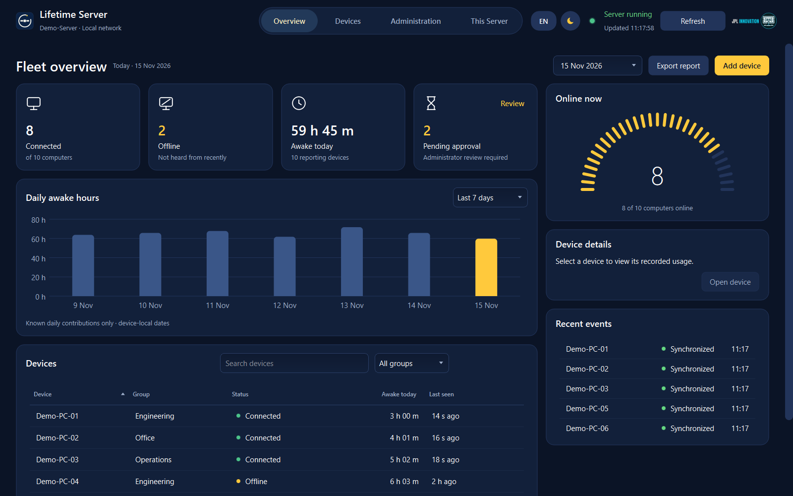
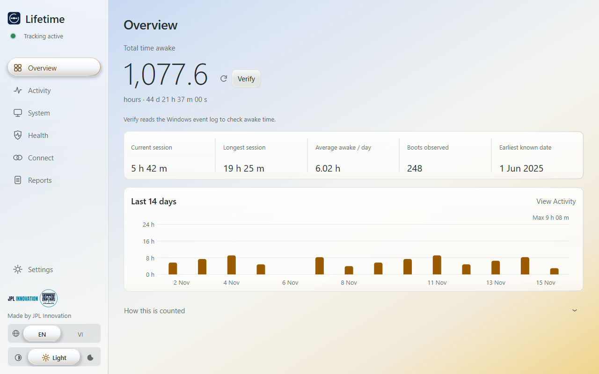

# Lifetime

**Lifetime records how long your computer has been running and awake.** Historical coverage is limited to recorded data and recoverable OS logs; the computer's true first-use date is usually unknown. Sleep and hibernation are excluded. It runs on Windows and Linux, in English and Tiếng Việt.

Made by [JPL Innovation](https://github.com/jpl-innovation).



| Activity | System |
|---|---|
|  |  |





Devices shows shared Activity, Health and hardware details for a demo computer.


## Choose your edition

| Edition | For | Download |
|---|---|---|
| **Lifetime for Windows** | Windows 10 / 11 laptops and desktops | `Lifetime-Windows.zip` |
| **Lifetime for Linux** | Any Linux desktop with glibc 2.28+ (Debian 10+, Ubuntu 20.04+, RHEL 8+, Fedora, openSUSE, Arch...) | `Lifetime-Linux-x86_64.AppImage` or `.tar.gz` |
| **Lifetime Server** | Windows Server, for IT teams that look after many computers | `Lifetime-Server-Windows.zip` |
| **Lifetime Server for Linux** | Any Linux server with glibc 2.28+ (no desktop needed), or any Linux with Docker/Podman | `Lifetime-Server-Linux-x86_64.tar.gz` (also `aarch64`), or the `Dockerfile` |

The Windows and Linux editions work fully on their own. Connecting a computer to a Lifetime Server is optional and only happens when someone chooses to. A connected computer streams live readings over one encrypted socket and can be restarted, put to sleep or shut down from the server, only if its owner allowed it.

### Connecting a computer to Lifetime Server

1. On the server, click **Add device** to show a code.
2. On the computer, choose **Connect**, enter that code, choose what to share, and click **Finish**. On Windows, accept the one permission prompt.
3. In the server's open **Add a computer** window, click **Approve**. The computer shows **Connected**.

For another network or VPN, click **Other network?** on the server and paste the connection line into the same code box. Both machines must be able to reach each other. Codes expire and work only with the intended server. The computer verifies the certificate before sending any data. See [SECURITY.md](SECURITY.md).

You can change sharing or disconnect from **Connect** at any time. Awake time is required; daily history and computer performance start on. Health starts on only with local Health consent. Remote sleep and restart start off and require a separate choice.

## Download

Go to the **[latest release](../../releases/latest)** and pick your system.

Every release also contains **SHA256SUMS.txt**. To check a download, run `sha256sum -c SHA256SUMS.txt` (Linux) or `Get-FileHash Lifetime-Windows.zip` (Windows) and compare the value.

### Windows 10 / 11 (no Python needed)

1. Download **Lifetime-Windows.zip** and unzip it.
2. Double-click **Install Lifetime.cmd**.
3. Approve the Windows prompt (see "Why admin?" below) and open **Lifetime** from the Start menu.

The downloaded programs are not code-signed, so Windows SmartScreen may say "Windows protected your PC". Click **More info → Run anyway**. **Smart App Control** (on by default on new Windows 11 PCs) blocks unsigned programs outright, with no "Run anyway" button. **Install Lifetime.cmd** detects this and automatically installs the Python version of Lifetime instead; if Python is missing it offers to install it with winget. You do not need to turn Smart App Control off.

**Python route** (works anywhere Python 3.11+ is installed):

```powershell
python -m pip install PyQt6
.\install_windows.ps1
```

### Lifetime Server (Windows Server)

1. Download **Lifetime-Server-Windows.zip** and unzip it on the server.
2. Follow [server operations](docs/SERVER_OPERATIONS.md) to install the service and open the firewall port you choose.
3. Open **Lifetime Server**, click **Add device**, and connect computers as described above.

### Lifetime Server for Linux (any distribution, headless)

The server runs on any Linux server with glibc 2.28 or newer, with no desktop and no system Python: Debian 10+, Ubuntu 20.04+, RHEL/AlmaLinux/Rocky 8+, Fedora, openSUSE Leap 15.3+, Arch, on x86_64 or aarch64.

```sh
tar -xzf Lifetime-Server-Linux-x86_64.tar.gz
cd Lifetime-Server-Linux-x86_64
sudo ./install_server_linux.sh --address https://server.school.lan:8443 --admin "$USER"
sudo /opt/lifetime-server/LifetimeServerRuntime admin --directory /var/lib/lifetime-server --admin-port 8444 --operation invitation
```

It installs to `/opt/lifetime-server`, keeps its data in `/var/lib/lifetime-server` (0700, system account `lifetime`) and runs as a systemd service that restarts on failure; without systemd it installs an OpenRC or SysV init script instead. The installer prints the firewall rule for `ufw` or `firewalld` (port 8443 from your local network only; the administration port 8444 stays on 127.0.0.1 and must never be opened). `root` and members of the `lifetime-admin` group are Admin; other Unix users and groups get Operator, Auditor or Viewer roles, exactly like Windows accounts on a Windows server: add the user to the `lifetime-console` group (which only lets them reach the admin socket and grants nothing by itself), then assign a role with `set_role`. Windows and Linux computers connect to a Linux server exactly as to a Windows one.

**Any Linux with Docker or Podman** (also musl hosts such as Alpine): `docker build -t lifetime-server .` in a source checkout, then see [server operations](docs/SERVER_OPERATIONS.md#linux-server). The container runs as a non-root user with its data in a volume.

**Dashboard:** on a Linux desktop, run `Lifetime-Linux-x86_64.AppImage --run-tool LifetimeServerDashboard --directory /var/lib/lifetime-server --admin-port 8444` against a server on the same computer. For a headless server, forward its admin socket over SSH (see [server operations](docs/SERVER_OPERATIONS.md#linux-server)); there is deliberately no network-reachable admin interface.

### Linux desktop (any distribution, no Python needed)

One build runs on every desktop distribution with glibc 2.28 or newer, on GNOME, KDE Plasma, XFCE, Cinnamon, MATE, LXQt and Budgie, under X11 or Wayland. It brings its own Python and Qt.

**AppImage** (nothing to install): download **Lifetime-Linux-x86_64.AppImage**, then

```sh
chmod +x Lifetime-Linux-x86_64.AppImage
./Lifetime-Linux-x86_64.AppImage
```

**Install for your user** (menu entry, `~/.local/lib/lifetime`, no root): download **Lifetime-Linux-x86_64.tar.gz**, then

```sh
tar -xzf Lifetime-Linux-x86_64.tar.gz
cd Lifetime-Linux-x86_64
./install_linux.sh            # ./uninstall_linux.sh removes it again; your history is kept
```

Tracking at login is chosen inside Lifetime. Where systemd runs it uses a systemd **user** service; on distributions without systemd (Devuan, antiX, MX with SysV, Void, Artix, Gentoo with OpenRC) it uses XDG autostart (`~/.config/autostart`), which every desktop above honours. Nothing needs root; sudo is only offered (never run on its own) to let you read the full system journal for earlier usage.

Without systemd there is no journal, so **Verify** and **Add earlier usage** say "Not available" and Lifetime counts from the day you install it. Missing tools (`nmcli`/`iw` for Wi-Fi, `lspci` for graphics names) only make those fields say "Not available". Remote power from a Lifetime Server uses `systemctl`, or without systemd `loginctl` (elogind) or logind over D-Bus, never sudo and never a password prompt; if none is available the server is told "not supported".

| Distribution | Versions | Verified |
|---|---|---|
| Debian | 10, 11, 12 | CI containers |
| Ubuntu (and Mint, Pop!\_OS, elementary, Zorin) | 20.04, 22.04, 24.04 | CI containers (derivatives share Ubuntu's base) |
| Fedora | current | CI container |
| RHEL, AlmaLinux, Rocky Linux | 8, 9 | CI containers (Rocky) |
| openSUSE Leap | 15.3 and newer | CI container |
| Arch Linux (and Manjaro, EndeavourOS) | rolling | CI container |
| Alpine and other musl distributions | — | **not supported** (the build needs glibc) |

"CI containers" means: the bundle and the AppImage start headless (`QT_QPA_PLATFORM=offscreen`) and pass `--self-check`, the tracker records, and a client enrolls with a Lifetime Server and syncs. Containers have no display, desktop session or systemd, so the window on real X11/Wayland desktops, login autostart and the tray still need checking on real machines (see the release notes). 64-bit x86 only for the desktop: PyQt6's ARM64 Linux wheels need a newer glibc than 2.28, so an ARM64 desktop build would not reach the same distributions (the server is built for ARM64).

**From source** (Python 3.11+ and PyQt6 from your distribution): run `bash install_linux.sh` in a source checkout.

## What it shows

- **Overview** – awake time ticking live to the second, with separate measured, reconstructed and manual-baseline amounts. **Earliest known date** names its source (OS installation, system-file timestamp, recovered log, first observation or unknown), not a claim of true first use. A **Verify** button cross-checks the current boot against the operating system's own records (the Windows event log or the Linux journal). Coverage stays unknown unless specific missing evidence supports a partial status.
- **Activity** – calendar heatmap, daily hours with a 7-day average, cumulative lifetime hours, hour-of-day and weekday profiles, and a session-length histogram, for 30 days, 90 days, a year or everything. **Show data** reveals the numbers behind every chart.
- **System** – live power and battery, network and Wi-Fi, graphics, CPU, memory and disks, each with a small five-minute trend next to its reading. A hardware section lists the computer's details in plain groups: processor (clock speed, and temperature where the computer reports it), cooling fans (count and speed where the firmware exposes them, otherwise it says so), network cards (name, Wi-Fi, Ethernet or virtual, link speed), memory modules, disks (model, SSD or HDD, health), motherboard and BIOS, graphics driver, displays and the operating system build. Anything a computer does not report shows "Not available" with a short reason; nothing is guessed. Serial numbers and user names are never collected.
- **Health** – stability (unexpected shutdowns and crashes), battery wear and cycles, and sleep patterns, when you allow Health. A 0-100 health score with its parts (unknown parts are shown and left out), and a **Replacement forecast**: when the battery reaches 80 % health and when the system disk runs out of room, or "not enough data" with what it has.
- **Reports** – export a PDF or CSV report, edit the device identity, review coverage, and see **Energy and cost**:
  kWh and money today, this week and this month from the awake time, with a note when the computer was on after
  office hours. Power is *measured* only from this computer's own on-battery readings (Battery permission);
  otherwise it is a typical or owner-set wattage and says *estimated*.
- **Connect** – connect to a Lifetime Server with one code and manage sharing.
- **Settings** – a page inside the app (not a pop-up window): language, appearance, what to track, adding earlier usage, start at login and deleting history. Every option is a sliding switch, green when on.
- **Lifetime Server** – a fleet view of every connected computer: who is connected, reports overdue, awake time today, pending approvals, a searchable device list, daily totals and recent events. Open a computer to see the same Activity and Health charts and the same hardware details as on the computer itself, limited to what its owner chose to share. If a computer shares no history or no readings, the server says so instead of showing empty charts.

### Appearance

- **Theme:** Auto (follows your system), Light or Dark. On the desktop it is at the bottom of the sidebar; on the server it is the round button in the header, and one click moves to the next choice.
- **Language:** English or Tiếng Việt. On the server it is the small rounded button in the header.
- **Style:** **Classic** (solid navy panels, the original look) or **Glass** (translucent panels over a soft blue-to-gold background, with a glass menu and a sliding pill that stretches towards the page you pick). The desktop starts in Classic and the server in Glass. Change it in Settings on the desktop, or on the **Administration** page of the server. All choices apply immediately and are remembered. Charts and numbers animate in once when a page opens, and everything respects the system "reduce motion" setting.

| App | Classic | Glass |
| --- | --- | --- |
| Lifetime |  |  |
| Lifetime Server |  |  |

Glass also supports a light theme:



## Privacy and consent

On first run Lifetime asks, one question at a time, what you want to track. Awake time is the only required item; battery, network, Wi-Fi name, graphics and resource readings are each opt-in, and anything you turn off is never read. Everything stays on your computer; nothing is uploaded. You can change choices, switch language, theme and style, or delete collected history on the **Settings** page at any time. Hardware, health and activity details are sent to a Lifetime Server only if you connected the computer and allowed history or readings; turning a choice off stops it at once.

**Why admin on Windows?** Adding your earlier usage (the time before you installed Lifetime) reads the full System event log and registering the login task works best with administrator rights. If you decline the prompt, Lifetime installs for your user only and history rebuild may be limited. The installer never installs files into the administrator's profile.

## How it counts

The tracker samples every 30 seconds using an awake-only clock (`QueryUnbiasedInterruptTime` on Windows, `CLOCK_MONOTONIC` on Linux), so suspend and hibernation are excluded and wall-clock changes cannot distort the counter. Gaps over five minutes start a new session. Each newly seen boot credits its awake time so far once. Live intervals split across local dates; initial boot time uses retained sleep/resume evidence when available and estimated calendar allocation otherwise (never more than 24 h per date). Past history can be rebuilt only from retained, accessible OS observations. Missing sleep events, log rotation, restricted permissions, unclean ends and Windows Fast Startup can limit reconstruction accuracy.

On the developer's laptop, the awake time reported by Lifetime matched the Windows event log to within a few minutes.

## Files and data

Data lives in `%APPDATA%\Lifetime\` (Windows) or `~/.local/share/lifetime/` (Linux): `ledger.json` (the record), `settings.json`, `status.json`. Back up `ledger.json` to keep your history. Uninstall: on Windows remove the *Lifetime Tracker* scheduled task, the shortcut and the install folder; on Linux run `uninstall_linux.sh` (or delete the AppImage and `~/.config/autostart/lifetime-*.desktop`).

## Build from source

```sh
python -m pip install PyQt6
python lifetime_gui.py          # open the window
python lifetime_tracker.py --run   # run the tracker
python -m unittest discover     # tests
```

Windows executables: `./build_windows.ps1` (needs `pyinstaller`, produces `package\`). Linux bundles: `packaging/linux/build_linux.sh build` inside a `rockylinux:8` container, then `packaging/linux/build_linux.sh package` (see `.github/workflows/windows.yml`). Releases are built automatically by GitHub Actions when a version tag such as `v1.0.0` is pushed.

## Supported systems

Windows 10 and 11 (x64 and ARM64), and Linux desktops with glibc 2.28 or newer (x86_64; with or without systemd; X11 or Wayland; see the table under Download). Lifetime Server runs on Windows Server and on Linux servers with glibc 2.28+ (x86_64 and aarch64) or in a container. Desktops without a battery or without an NVIDIA GPU are handled. Windows 10, ARM64, non-English Windows and Linux paths are covered by automated tests but have had less real-world testing than Windows 11 x64.

## Troubleshooting and known issues

- **Windows says "Windows protected your PC".** The programs are not code-signed yet. Choose **More info -> Run anyway**, or use the Python route above.
- **Linux: Verify shows a gap of a couple of minutes after a suspend.** On some laptops the journal timestamps for suspend events are approximate, so the comparison can be off by about the length of the sleep. The total itself comes from the awake-only clock and is not affected. To help fix this, run `python3 lifetime_signals.py --verify-debug` (from a source checkout) right after a suspend and resume, and attach the output to an issue.
- **Linux: the window does not open.** Run `Lifetime --self-check` (or `./Lifetime-Linux-x86_64.AppImage --self-check`) in a terminal and attach its output to an issue. On Wayland, `QT_QPA_PLATFORM=xcb` forces X11 (XWayland) if your compositor has a problem. If an AppImage says FUSE is missing, run it with `--appimage-extract-and-run` or use the tar.gz.
- **Linux: no Wi-Fi or graphics details.** Wi-Fi uses NetworkManager (`nmcli`) or `iw`; graphics names use `lspci`. Install them with your package manager if a field shows "Not available".
- **Something else.** Open an issue on GitHub with your operating system, Python version and the exact message.

## Credits and license

Lifetime · Made by JPL Innovation

Lifetime is free software under the [GNU General Public License v3](LICENSE) (GPL-3.0-only): free to use, including in a business, and free to copy, change and share, as long as anyone you give it to gets the same rights and the source code. It is built on PyQt6, Qt, cryptography, websockets and pywin32; their licenses are listed in [THIRD_PARTY_NOTICES.md](THIRD_PARTY_NOTICES.md).

## Technician workflow

**Device identity** adds an optional display name, asset tag, department/location and
deployment date (YYYY-MM-DD). Leave any field blank or clear it later; no business
profile is required. Values are saved locally in the existing `settings.json` without
changing consent. The existing Settings interview and EN/VI selector continue to work.
An existing system name is used as a clearly labeled UI fallback only when Resources
consent permits it; it is never added automatically to a report.

**Coverage details** explains proven recording start (when saved), earliest recovered
OS record, first/last recorded dates, sources, gaps and estimated allocation. Older
versions may not have preserved an exact recording-start timestamp. The OS-date clue
is not a manufacture, purchase or true first-use date. A successful Verify comparison
applies to the current boot and does not prove complete historical coverage.

Awake time does not measure human activity, productivity, component health or remaining
lifespan. Missing dates are unavailable rather than assumed to be zero-use days.
Daily retention remains 400 days and session retention remains 100 records. Historical
calendar attribution can be estimated; changing timezone does not relabel saved dates.

## Local customer reports

Choose **Export report**, select all available data or an inclusive local-date range,
choose optional fields individually, then **Preview** before saving PDF or CSV. The
report includes version/build, creation time with UTC offset, requested range,
available awake/session statistics, relevant record dates, sources and limitations.
Blank/unknown values are labeled unavailable, and out-of-coverage ranges are explained.
The undated manual baseline is listed separately for all-data reports and is excluded
from period totals. Exact session durations inside a selected range are unavailable
from aggregate session counters; retained session starts are scoped separately.

All generation stays local. Nothing is uploaded, emailed or shared, and exporting never
starts tracking or changes collection choices. Identity and system fields are excluded
by default. System export fields also require existing Resources consent. When History
is off, dated records and retained sessions are excluded, including previously saved
data. A pending first-run interview cannot export. Settings and the ledger are read again
after choosing a destination; changed data/permissions require a fresh preview and review.

PDF uses existing Qt and installed Unicode fonts, including Vietnamese diacritics; no
new runtime dependency is required. Preview/PDF include up to 90 daily rows to remain
responsive; aggregate totals cover all selected retained rows. CSV includes every
selected daily row and uses UTF-8 with BOM, standard comma/quote/newline escaping,
YYYY-MM-DD local dates and durations in seconds. Columns are
`section,field,value,local_date,awake_seconds`: the first three carry metadata/statistics;
the last two carry daily values. Schema/field keys remain English; explanation values
follow report language. Formula-like user text is prefixed with an apostrophe, including
when preceded by whitespace/control characters.

Cancellation writes nothing. Replacing a destination needs confirmation. Output and
settings use temporary sibling files and atomic replacement so failed writes do not
destroy the previous valid file. Choose another writable location if a save fails.

## Upgrading and verification

Rerun the normal installer to copy the new modules; keep the existing data directory,
`ledger.json` and `settings.json`. Existing consent, settings extensions and history are
retained. Malformed ledger fields fail visibly instead of resetting totals. Malformed
settings still fail closed; identity updates refuse to overwrite damaged settings.
Back up the file before manual repair/restoration. Imports remain idempotent and use
the existing shared ledger lock and pre-import backup.

For damaged saved data, explicit recovery is available:

```sh
python lifetime_tracker.py --recover
```

Recovery keeps the original bytes as `ledger.json.corrupt-*` before replacing anything.
It can filter/reset damaged derived history and lists every change. Core accounting,
boot boundaries and imported accounting markers are never guessed or reset. If these
are damaged, recovery restores the newest valid `ledger.json.bak*` or `backup-*/ledger.json`;
with no valid backup the original remains untouched. A restored backup can omit usage
recorded after that backup. Older incomplete import markers remain readable but cannot
authorize another import, preventing double counting. Legacy per-day totals above 24 h
remain loadable so the existing explicit/upgrade daily-repair migration can process them.

Legacy dates with no saved provenance are labeled unknown. An imported log date is not
proof of manufacture, purchase or first use. The overview uses an awake-only clock for
its live interpolation, and reports use saved counter snapshots. Motion is short and
stops when hidden; `LIFETIME_REDUCE_MOTION=1` disables it. English/Vietnamese and 100%/200%
layout captures are supported by the synthetic render helper.

```sh
python -m unittest discover -v
python render_technician.py
```

The render script uses only synthetic local data and writes EN/VI PDF/CSV and release
UI captures to `.qa/technician/`. See `TECHNICIAN_VERIFICATION.md` for the source comparison,
tests performed, changed files, tradeoffs and remaining physical-platform checks.


## Lifetime Server: setup details for IT

Lifetime's existing desktop remains usable on its own, with the same local ledger,
English/Vietnamese interface, Verify, System and Insights screens, and first-run
consent choices. The optional **Connect** page reads local status when opened.
Reporting starts only after you review sharing and click Finish. No employee account
is required. Remote sleep and restart require separate consent and a one minute warning.

The server edition adds a native dashboard, a separate HTTPS reporting runtime and
a protected, loopback-only administration API. Company reporting uses a separate
machine ledger; it never silently combines Windows users' histories. Identity and
sequence numbers survive reconnects. Optional dated history and basic system fields
start on in Connect, where you can turn them off before sending anything. Server identity edits own the server's
metadata and are not overwritten by client usage updates.

From a source checkout, using an elevated terminal for the server runtime and agent:

```powershell
# Existing desktop: no additional dependencies.
python lifetime_gui.py

# Server-only environment; use your existing PyQt6-capable Python.
python -m venv --system-site-packages .venv-server
.venv-server/Scripts/python.exe -m pip install -r requirements-server.txt

# Choose a real LAN hostname/IP for Address before generating the certificate.
.venv-server/Scripts/python.exe lifetime_server.py console --directory C:\ProgramData\Lifetime\Server --address https://YOUR-SERVER:8443 --port 8443 --admin-port 8444

# Run in another local terminal on that server.
python lifetime_server_gui.py --directory C:\ProgramData\Lifetime\Server --admin-port 8444 --language en
```

Use **Add device** on the server and **Connect** on the computer as described above.
Windows Finish asks for administrator permission once and starts the machine agent.
A packaged installation uses the adjacent `install_agent_windows.ps1` and
`LifetimeAgent.exe`; a source run starts a detached hidden agent directly.
Linux uses a private user reporting directory and tries to enable the user service.
Approval appears in the same server window that shows the code.

For a source agent, `python lifetime_agent.py --help` lists explicit initialization,
enrollment-file, one-time ledger import and run options. An initial per-user ledger
import requires reliable boot/awake-clock boundaries and is refused after machine
sampling starts; repeated imports do not increase the counter. Install the startup
task for recording before login and after sign-out. The source console alone stops
when its process exits.

Device and fleet exports reuse the local PDF/CSV format and preview. Optional
identity fields now also include a separate **Location**; earlier combined
department/location text is preserved unchanged. Fleet totals sum one latest
cumulative snapshot per selected device. Missing devices are excluded from the
explicitly identified known subtotal, and missing data never becomes zero. Daily
fleet rows sum matching saved device-local date labels, which can span different
timezones. Baselines remain undated estimates outside selected-period totals.

The server renews its certificate from the same key and computers pin that key, so
renewals and new server names need no re-pairing; only a new server key does.
Disabling a reporting category prevents
future collection/transmission and removes its server snapshot at the next permitted
sync. Stopping reporting locally performs no further requests; the server's existing
data then requires its administrator or retention policy to remove it. Previously
exported files are outside that policy. Reports are never uploaded or shared.

### Alerts and incidents

Lifetime Server tells you when something is wrong, using only what the computers already send. Built-in rules
(each can be turned off, with its own threshold and duration under **Administration > Alert rules**): computer
offline longer than N minutes during its expected online hours, no report for N minutes, disk free below X %,
processor or memory above X %, battery health below X %, temperature above X °C (only where a sensor reports one),
repeated crashes (from Health, only when the computer shares Health) and a Lifetime version older than a minimum you
set. A problem must last the whole duration before an incident opens and stay away five minutes before it resolves,
so short spikes and flapping do not flood anyone. A computer that does not share a reading is never alerted on it;
readings that stop arriving show as "telemetry missing" on the computer, not as a failure.

- **Incidents** lists current and past problems: one incident per continuous problem, with its timeline, who
  acknowledged it and when, and when it recovered. The header shows the number of open alerts.
- **Groups**: **Manage groups** on the Devices page creates groups before any computer is in them; pick one when
  approving a computer or under **Edit details…** in a device's menu (name, asset tag, group, location, deployment
  date). Renaming a group carries its computers and its hours, maintenance windows, sleep policy and wattage along.
- **Expected online hours** (everyone, a group or one computer): always, never, or business hours with a time zone,
  weekdays and holidays. The default expects desktops always and laptops never, so a laptop asleep after work
  raises nothing. **Maintenance windows** pause alerts.
- **Network checks** for printers, routers, NAS boxes and websites that do not run Lifetime: ping, TCP port or a web
  page (status, optional keyword, certificate checked), limited to the networks you allow; a check failing three
  times in a row opens one incident.
- **Availability and reports**: monthly (or any period) reports per computer, group or fleet, in PDF or CSV, show
  awake time and availability side by side but separately, with coverage and unknown time, incidents, a health
  summary and replacement candidates with their reasons. Availability counts only expected online hours and never
  counts unknown time (the server was off, the computer had not reported) as up or down.
- **Notifications**: one email when an incident opens and one when it recovers (SMTP with STARTTLS or TLS), retried
  and logged; an optional daily summary and an optional webhook for Teams, Slack or Telegram bridges, both off by
  default. Messages name the computer and the problem only. See
  [server operations](docs/SERVER_OPERATIONS.md#alerts-and-notifications).

Monitoring keeps its own history (`monitoring.sqlite`) next to the server database, saved and restored with the
dashboard's backup archive; time when the server itself was not running is shown as unknown, never as
offline. Time zone names such as `Asia/Ho_Chi_Minh` use the `tzdata` package from `requirements-server.txt`.
Network checks are not yet verified against real devices or websites. Not yet verified with a real mail server or webhook service
(tests use a local SMTP stub and a fake webhook).

### Named administrators, roles and the audit trail

On Windows the dashboard signs in as the Windows account that opens it: the server reads that account from its
local named pipe (it cannot be typed in or faked by the dashboard) and applies its role. Administrators running as
administrator and SYSTEM are always **Admin**; under **Administration > Roles and access** an Admin gives other
Windows accounts or groups a role: **Operator** (view, acknowledge incidents, maintenance windows, refresh, and remote
power for one computer at a time where its owner allowed it), **Auditor** (view and the audit trail) or **Viewer**
(view only). The server checks the role on every request; the dashboard greys out what the role cannot do and says
why. Whoever can read the `admin-token` file (Administrators and SYSTEM) is also Admin through the older loopback
channel, which older dashboards use; remote power needs a named account, so it is not available through the
token. On a Linux server the same roles apply to Unix users and groups over a local socket (root and
`lifetime-admin` are Admin); see [server operations](docs/SERVER_OPERATIONS.md#linux-server). **Audit trail** records every change and every remote command with the Windows account, role,
target, result and time, hash-chained so an edited or removed entry is detected (**Verify audit trail**, **Export
CSV**). **Backup and restore** writes one protected `.zip` archive with a `.sha256` file and restores it at the next
server start. See [server operations](docs/SERVER_OPERATIONS.md#named-administrators-and-roles) and
[SECURITY](SECURITY.md#named-administrators-roles-and-the-audit-trail). Verified with tests on one Windows 11 PC
only, not yet with domain accounts and groups on a real Windows Server.

### Agent updates

Under **Administration > Agent updates** an Admin uploads an approved agent package with its published SHA-256 and
version, offers it to a share of computers (start with 10 %), and can pause or roll back. Only computers whose owner
switched on *Get Lifetime updates approved by the server* take part (off by default). They download the package over
their pinned connection, check its SHA-256 and, on Windows, its signature when it has one, keep it ready and report
back; they never run it. `install_agent_windows.ps1 -StagedUpdate` installs it, for example from a startup script at
the next restart. See [server operations](docs/SERVER_OPERATIONS.md#agent-updates-staged). Not yet verified from a
real GPO or Intune startup script.

### Energy, after hours, replacements and health (the Energy page)

Lifetime knows each computer's true awake time, so the server's **Energy** page can say what others cannot:

- **Energy and cost** per computer, group and fleet (today, 7 and 30 days, daily chart, top consumers): awake hours
  x power draw, at your electricity price (default 2,500 VND per kWh; any currency). Power is **measured** only when a
  computer reported its own draw on battery (at least 3 readings); otherwise it is the wattage you set for the
  computer or its group, or a typical laptop (20 W) or desktop (80 W), and is labelled **estimated** with its source.
- **After hours**: awake time outside each computer's business hours (its expected-online schedule) or the office
  hours you set (default 08:00-18:00, Monday-Friday), per computer, room, group and fleet, with energy, cost, an
  8-week trend and the estimated monthly saving. **Sleep after hours** for a group sends the ordinary single-computer
  Sleep command, once a night, 30 minutes after closing, only to computers whose owner allows remote power, within the
  usual rate limits and audited as the Admin or Operator who turned it on. It skips computers that are offline, busy or
  already have a command, and does not insist if a computer is woken or its owner declines.
- **Replacement plan**: when each battery falls below the replacement level and when each system disk fills, from the
  computer's own readings (a date only with at least 4 readings over 30 days, otherwise "not enough data"), disks that
  report a problem, age and awake hours, what to replace this quarter and this year, and a budget from unit prices you
  set.
- **Health score** 0-100 per computer, averaged per group and fleet: stability, battery wear, system disk free,
  temperature and agent version; a part without a reading is shown as unknown and never counted as good or bad.

Reports (PDF and CSV) carry the same figures with how each one was obtained. Nothing here is verified on real
fleets yet: the numbers are tested with hand-calculated cases and demo data only.

### Tested size

One simulated fleet of 50 computers ran against a test server on one Windows 11 PC
([docs/benchmarks](docs/benchmarks/README.md)). Supported size = tested size: larger fleets are not claimed until
`tools/fleet_simulator.py` has been run at that size.

### Pilots and roadmap status

[docs/pilot](docs/pilot/site-checklist.md) has what a pilot site needs: a checklist, a consent and data policy template
in English and Vietnamese, a support runbook, an evidence log, the side-by-side protocol with Zabbix and an interview
script. [docs/ROADMAP_STATUS.md](docs/ROADMAP_STATUS.md) lists every roadmap item with what is implemented, what is
tested only synthetically, what still needs real machines and what needs a decision.

See [server protocol](docs/SERVER_PROTOCOL.md) and
[server operations and deployment checks](docs/SERVER_OPERATIONS.md) for trust,
administrator access, installation, firewall choices, retention, backups, restore,
upgrade and rollback. A database restore invalidates credentials and pairing tokens,
so devices must be re-enrolled. Back up TLS/configuration files separately and keep
all backups restricted.

Development verification uses Windows 11, Python 3.12 and headless Qt. Local simulated
clients exercise real HTTPS, enrollment and SQLite transactions. Actual Windows
Server, SCM installation, startup tasks across real reboots, production ACLs and
firewall behavior remain unverified until the documented deployment checks run.
No Windows Server version is claimed as tested.

## Project layout

- `lifetime_*.py`: the application modules. Main groups: desktop (`lifetime_gui.py`, `lifetime_shell.py`, `lifetime_setup.py` for the Settings page, `lifetime_charts.py`, `lifetime_health*.py`, `lifetime_system*.py` for the System page, shared by the desktop and the server), shared look (`lifetime_theme.py`, `lifetime_glass.py` for the Glass and Classic styles, `lifetime_reveal.py` for the entrance animations), server (`lifetime_server*.py`), agent and protocol (`lifetime_agent.py`, `lifetime_protocol.py`), and the live channel (`lifetime_ws*.py`, `lifetime_live.py`).
- `test_*.py`: unit and GUI tests. Run `python -m unittest discover -p "test_*.py"` with `QT_QPA_PLATFORM=offscreen`.
- `render_*.py`: scripts that render the screens with synthetic data for design review. They never read real data.
- `install_*`, `build_*`, `uninstall_*`: Windows and Linux installers and build scripts.
- `docs/`: [index](docs/README.md) of design notes, protocol and operations guides.
