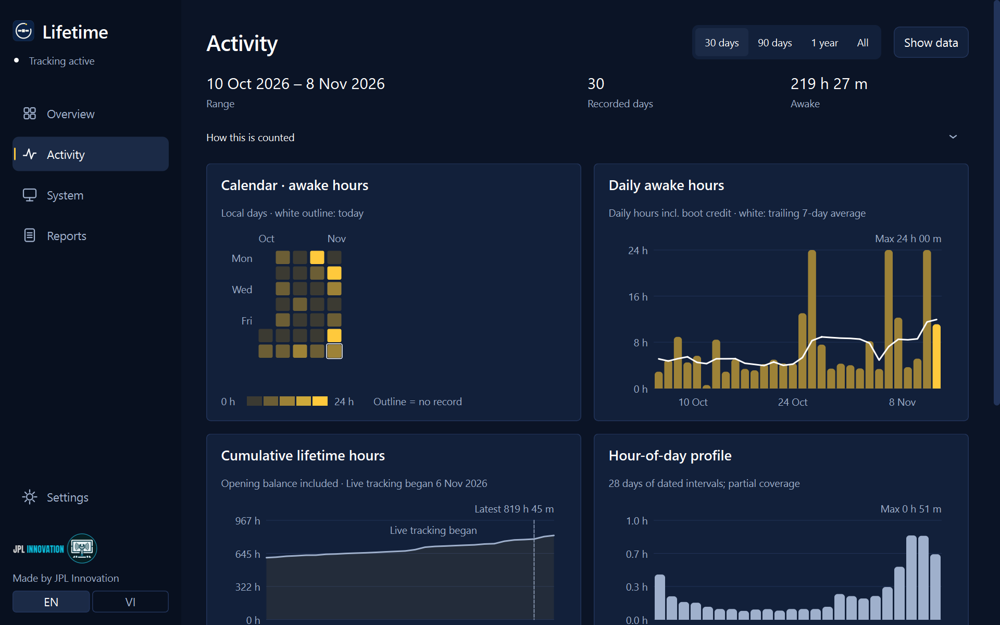
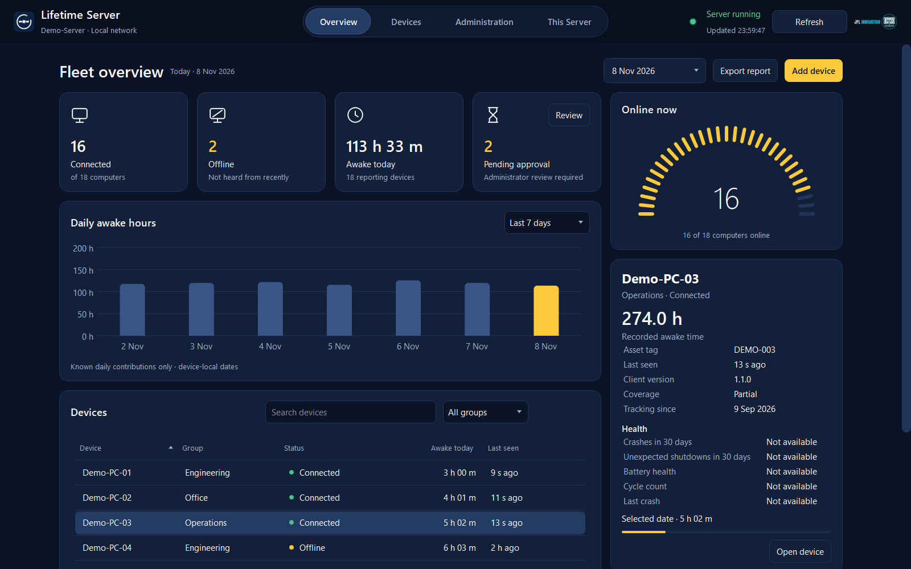

# Lifetime

**Lifetime records how long your computer has been running and awake.** Historical coverage is limited to recorded data and recoverable OS logs; the computer's true first-use date is usually unknown. Sleep and hibernation are excluded. It runs on Windows and Linux, in English and Tiếng Việt.

Made by [JPL Innovation](https://github.com/jpl-innovation).


| Activity | System |
|---|---|
|  |  |




## Choose your edition

| Edition | For | Download |
|---|---|---|
| **Lifetime for Windows** | Windows 10 / 11 laptops and desktops | `Lifetime-Windows.zip` |
| **Lifetime for Linux** | Linux with systemd and Python 3.11+ | `Lifetime-Linux.tar.gz` |
| **Lifetime Server** | Windows Server, for IT teams that look after many computers | `Lifetime-Server-Windows.zip` |

The Windows and Linux editions work fully on their own. Connecting a computer to a Lifetime Server is optional and only happens when someone chooses to. A connected computer streams live readings over one encrypted socket and can be restarted, put to sleep or shut down from the server, only if its owner allowed it.

### Connecting a computer to Lifetime Server

1. On the server, click **Add device** to show a code.
2. On the computer, choose **Connect**, enter that code, choose what to share, and click **Finish**. On Windows, accept the one permission prompt.
3. In the server's open **Add a computer** window, click **Approve**. The computer shows **Connected**.

For another network or VPN, click **Other network?** on the server and paste the connection line into the same code box. Both machines must be able to reach each other. Codes expire and work only with the intended server. The computer verifies the certificate before sending any data. See [SECURITY.md](SECURITY.md).

You can change sharing or disconnect from **Connect** at any time. Awake time is required; daily history and computer performance start on. Health starts on only with local Health consent. Remote sleep and restart start off and require a separate choice.

## Download

Go to the **[latest release](../../releases/latest)** and pick your system.

Every release also contains **SHA256SUMS.txt**. To check a download, run `sha256sum -c SHA256SUMS.txt` (Linux) or `Get-FileHash Lifetime-Windows.zip` (Windows) and compare the value.

### Windows 10 / 11 (no Python needed)

1. Download **Lifetime-Windows.zip** and unzip it.
2. Double-click **Install Lifetime.cmd**.
3. Approve the Windows prompt (see "Why admin?" below) and open **Lifetime** from the Start menu.

The downloaded programs are not code-signed, so Windows SmartScreen may say "Windows protected your PC". Click **More info → Run anyway**. **Smart App Control** (on by default on new Windows 11 PCs) blocks unsigned programs outright, with no "Run anyway" button. **Install Lifetime.cmd** detects this and automatically installs the Python version of Lifetime instead; if Python is missing it offers to install it with winget. You do not need to turn Smart App Control off.

**Python route** (works anywhere Python 3.11+ is installed):

```powershell
python -m pip install PyQt6
.\install_windows.ps1
```

### Lifetime Server (Windows Server)

1. Download **Lifetime-Server-Windows.zip** and unzip it on the server.
2. Follow [server operations](docs/SERVER_OPERATIONS.md) to install the service and open the firewall port you choose.
3. Open **Lifetime Server**, click **Add device**, and connect computers as described above.

### Linux

1. Download **Lifetime-Linux.tar.gz**, then:

```sh
tar -xzf Lifetime-Linux.tar.gz
cd Lifetime-Linux
bash install_linux.sh
```

2. Open **Lifetime** from your application menu.

The installer needs Python 3 and PyQt6 and offers to install PyQt6 for you (no sudo, unless you choose to allow journal access). Distribution packages: `python3-pyqt6` (Debian/Ubuntu/Fedora) or `python-pyqt6` (Arch). It sets up a systemd **user** service, so no root rights are needed.

## What it shows

- **Overview** – awake time ticking live to the second, with separate measured, reconstructed and manual-baseline amounts. **Earliest known date** names its source (OS installation, system-file timestamp, recovered log, first observation or unknown), not a claim of true first use. A **Verify** button cross-checks the current boot against the operating system's own records (the Windows event log or the Linux journal). Coverage stays unknown unless specific missing evidence supports a partial status.
- **Activity** – calendar heatmap, daily hours with a 7-day average, cumulative lifetime hours, hour-of-day and weekday profiles, and a session-length histogram, for 30 days, 90 days, a year or everything. **Show data** reveals the numbers behind every chart.
- **System** – live power and battery, network and Wi-Fi, graphics, CPU, memory and disks, each with a small five-minute trend next to its reading.
- **Reports** – export a PDF or CSV report, edit the device identity, review coverage.
- **Connect** ? connect to a Lifetime Server with one code and manage sharing.
- **Lifetime Server** – a fleet view of every connected computer: who is connected, reports overdue, awake time today, pending approvals, a searchable device list with details, daily totals and recent events.

## Privacy and consent

On first run Lifetime asks, one question at a time, what you want to track. Awake time is the only required item; battery, network, Wi-Fi name, graphics and resource readings are each opt-in, and anything you turn off is never read. Everything stays on your computer; nothing is uploaded. You can change choices, switch language, or delete collected history in **Settings**.

**Why admin on Windows?** Rebuilding past history reads the full System event log and registering the login task works best with administrator rights. If you decline the prompt, Lifetime installs for your user only and history rebuild may be limited. The installer never installs files into the administrator's profile.

## How it counts

The tracker samples every 30 seconds using an awake-only clock (`QueryUnbiasedInterruptTime` on Windows, `CLOCK_MONOTONIC` on Linux), so suspend and hibernation are excluded and wall-clock changes cannot distort the counter. Gaps over five minutes start a new session. Each newly seen boot credits its awake time so far once. Live intervals split across local dates; initial boot time uses retained sleep/resume evidence when available and estimated calendar allocation otherwise (never more than 24 h per date). Past history can be rebuilt only from retained, accessible OS observations. Missing sleep events, log rotation, restricted permissions, unclean ends and Windows Fast Startup can limit reconstruction accuracy.

On the developer's laptop, the awake time reported by Lifetime matched the Windows event log to within a few minutes.

## Files and data

Data lives in `%APPDATA%\Lifetime\` (Windows) or `~/.local/share/lifetime/` (Linux): `ledger.json` (the record), `settings.json`, `status.json`. Back up `ledger.json` to keep your history. Uninstall: remove the *Lifetime Tracker* scheduled task / `lifetime-tracker.service`, the shortcut, and the install folder.

## Build from source

```sh
python -m pip install PyQt6
python lifetime_gui.py          # open the window
python lifetime_tracker.py --run   # run the tracker
python -m unittest discover     # tests
```

Windows executables: `./build_windows.ps1` (needs `pyinstaller`, produces `package\`). Releases are built automatically by GitHub Actions when a version tag such as `v1.0.0` is pushed.

## Supported systems

Windows 10 and 11 (x64 and ARM64), and Linux with systemd and Python 3.11+. Desktops without a battery or without an NVIDIA GPU are handled. Windows 10, ARM64, non-English Windows and Linux paths are covered by automated tests but have had less real-world testing than Windows 11 x64.

## Troubleshooting and known issues

- **Windows says "Windows protected your PC".** The programs are not code-signed yet. Choose **More info -> Run anyway**, or use the Python route above.
- **Linux: Verify shows a gap of a couple of minutes after a suspend.** On some laptops the journal timestamps for suspend events are approximate, so the comparison can be off by about the length of the sleep. The total itself comes from the awake-only clock and is not affected. To help fix this, run `python3 lifetime_signals.py --verify-debug` right after a suspend and resume, and attach the output to an issue.
- **Linux: no Wi-Fi or graphics details.** Wi-Fi uses NetworkManager (`nmcli`) or `iw`; graphics names use `lspci`. Install them with your package manager if a field shows "Not available".
- **Something else.** Open an issue on GitHub with your operating system, Python version and the exact message.

## Credits

Lifetime · Made by JPL Innovation

## Technician workflow

**Device identity** adds an optional display name, asset tag, department/location and
deployment date (YYYY-MM-DD). Leave any field blank or clear it later; no business
profile is required. Values are saved locally in the existing `settings.json` without
changing consent. The existing Settings interview and EN/VI selector continue to work.
An existing system name is used as a clearly labeled UI fallback only when Resources
consent permits it; it is never added automatically to a report.

**Coverage details** explains proven recording start (when saved), earliest recovered
OS record, first/last recorded dates, sources, gaps and estimated allocation. Older
versions may not have preserved an exact recording-start timestamp. The OS-date clue
is not a manufacture, purchase or true first-use date. A successful Verify comparison
applies to the current boot and does not prove complete historical coverage.

Awake time does not measure human activity, productivity, component health or remaining
lifespan. Missing dates are unavailable rather than assumed to be zero-use days.
Daily retention remains 400 days and session retention remains 100 records. Historical
calendar attribution can be estimated; changing timezone does not relabel saved dates.

## Local customer reports

Choose **Export report**, select all available data or an inclusive local-date range,
choose optional fields individually, then **Preview** before saving PDF or CSV. The
report includes version/build, creation time with UTC offset, requested range,
available awake/session statistics, relevant record dates, sources and limitations.
Blank/unknown values are labeled unavailable, and out-of-coverage ranges are explained.
The undated manual baseline is listed separately for all-data reports and is excluded
from period totals. Exact session durations inside a selected range are unavailable
from aggregate session counters; retained session starts are scoped separately.

All generation stays local. Nothing is uploaded, emailed or shared, and exporting never
starts tracking or changes collection choices. Identity and system fields are excluded
by default. System export fields also require existing Resources consent. When History
is off, dated records and retained sessions are excluded, including previously saved
data. A pending first-run interview cannot export. Settings and the ledger are read again
after choosing a destination; changed data/permissions require a fresh preview and review.

PDF uses existing Qt and installed Unicode fonts, including Vietnamese diacritics; no
new runtime dependency is required. Preview/PDF include up to 90 daily rows to remain
responsive; aggregate totals cover all selected retained rows. CSV includes every
selected daily row and uses UTF-8 with BOM, standard comma/quote/newline escaping,
YYYY-MM-DD local dates and durations in seconds. Columns are
`section,field,value,local_date,awake_seconds`: the first three carry metadata/statistics;
the last two carry daily values. Schema/field keys remain English; explanation values
follow report language. Formula-like user text is prefixed with an apostrophe, including
when preceded by whitespace/control characters.

Cancellation writes nothing. Replacing a destination needs confirmation. Output and
settings use temporary sibling files and atomic replacement so failed writes do not
destroy the previous valid file. Choose another writable location if a save fails.

## Upgrading and verification

Rerun the normal installer to copy the new modules; keep the existing data directory,
`ledger.json` and `settings.json`. Existing consent, settings extensions and history are
retained. Malformed ledger fields fail visibly instead of resetting totals. Malformed
settings still fail closed; identity updates refuse to overwrite damaged settings.
Back up the file before manual repair/restoration. Imports remain idempotent and use
the existing shared ledger lock and pre-import backup.

For damaged saved data, explicit recovery is available:

```sh
python lifetime_tracker.py --recover
```

Recovery keeps the original bytes as `ledger.json.corrupt-*` before replacing anything.
It can filter/reset damaged derived history and lists every change. Core accounting,
boot boundaries and imported accounting markers are never guessed or reset. If these
are damaged, recovery restores the newest valid `ledger.json.bak*` or `backup-*/ledger.json`;
with no valid backup the original remains untouched. A restored backup can omit usage
recorded after that backup. Older incomplete import markers remain readable but cannot
authorize another import, preventing double counting. Legacy per-day totals above 24 h
remain loadable so the existing explicit/upgrade daily-repair migration can process them.

Legacy dates with no saved provenance are labeled unknown. An imported log date is not
proof of manufacture, purchase or first use. The overview uses an awake-only clock for
its live interpolation, and reports use saved counter snapshots. Motion is short and
stops when hidden; `LIFETIME_REDUCE_MOTION=1` disables it. English/Vietnamese and 100%/200%
layout captures are supported by the synthetic render helper.

```sh
python -m unittest discover -v
python render_technician.py
```

The render script uses only synthetic local data and writes EN/VI PDF/CSV and release
UI captures to `.qa/technician/`. See `TECHNICIAN_VERIFICATION.md` for the source comparison,
tests performed, changed files, tradeoffs and remaining physical-platform checks.


## Lifetime Server: setup details for IT

Lifetime's existing desktop remains usable on its own, with the same local ledger,
English/Vietnamese interface, Verify, System and Insights screens, and first-run
consent choices. The optional **Connect** page reads local status when opened.
Reporting starts only after you review sharing and click Finish. No employee account
is required. Remote sleep and restart require separate consent and a one minute warning.

The server edition adds a native dashboard, a separate HTTPS reporting runtime and
a protected, loopback-only administration API. Company reporting uses a separate
machine ledger; it never silently combines Windows users' histories. Identity and
sequence numbers survive reconnects. Optional dated history and basic system fields
start on in Connect, where you can turn them off before sending anything. Server identity edits own the server's
metadata and are not overwritten by client usage updates.

From a source checkout, using an elevated terminal for the server runtime and agent:

```powershell
# Existing desktop: no additional dependencies.
python lifetime_gui.py

# Server-only environment; use your existing PyQt6-capable Python.
python -m venv --system-site-packages .venv-server
.venv-server/Scripts/python.exe -m pip install -r requirements-server.txt

# Choose a real LAN hostname/IP for Address before generating the certificate.
.venv-server/Scripts/python.exe lifetime_server.py console --directory C:\ProgramData\Lifetime\Server --address https://YOUR-SERVER:8443 --port 8443 --admin-port 8444

# Run in another local terminal on that server.
python lifetime_server_gui.py --directory C:\ProgramData\Lifetime\Server --admin-port 8444 --language en
```

Use **Add device** on the server and **Connect** on the computer as described above.
Windows Finish asks for administrator permission once and starts the machine agent.
A packaged installation uses the adjacent `install_agent_windows.ps1` and
`LifetimeAgent.exe`; a source run starts a detached hidden agent directly.
Linux uses a private user reporting directory and tries to enable the user service.
Approval appears in the same server window that shows the code.

For a source agent, `python lifetime_agent.py --help` lists explicit initialization,
enrollment-file, one-time ledger import and run options. An initial per-user ledger
import requires reliable boot/awake-clock boundaries and is refused after machine
sampling starts; repeated imports do not increase the counter. Install the startup
task for recording before login and after sign-out. The source console alone stops
when its process exits.

Device and fleet exports reuse the local PDF/CSV format and preview. Optional
identity fields now also include a separate **Location**; earlier combined
department/location text is preserved unchanged. Fleet totals sum one latest
cumulative snapshot per selected device. Missing devices are excluded from the
explicitly identified known subtotal, and missing data never becomes zero. Daily
fleet rows sum matching saved device-local date labels, which can span different
timezones. Baselines remain undated estimates outside selected-period totals.

Certificate rotation requires re-pairing. Disabling a reporting category prevents
future collection/transmission and removes its server snapshot at the next permitted
sync. Stopping reporting locally performs no further requests; the server's existing
data then requires its administrator or retention policy to remove it. Previously
exported files are outside that policy. Reports are never uploaded or shared.

See [server protocol](docs/SERVER_PROTOCOL.md) and
[server operations and deployment checks](docs/SERVER_OPERATIONS.md) for trust,
administrator access, installation, firewall choices, retention, backups, restore,
upgrade and rollback. A database restore invalidates credentials and pairing tokens,
so devices must be re-enrolled. Back up TLS/configuration files separately and keep
all backups restricted.

Development verification uses Windows 11, Python 3.12 and headless Qt. Local simulated
clients exercise real HTTPS, enrollment and SQLite transactions. Actual Windows
Server, SCM installation, startup tasks across real reboots, production ACLs and
firewall behavior remain unverified until the documented deployment checks run.
No Windows Server version is claimed as tested.

## Project layout

- `lifetime_*.py`: the application modules (desktop, Linux, server, agent, protocol, live channel).
- `test_*.py`: unit and GUI tests. Run `python -m unittest discover -p "test_*.py"` with `QT_QPA_PLATFORM=offscreen`.
- `render_*.py`: scripts that render the screens with synthetic data for design review. They never read real data.
- `install_*`, `build_*`, `uninstall_*`: Windows and Linux installers and build scripts.
- `docs/`: [index](docs/README.md) of design notes, protocol and operations guides.
